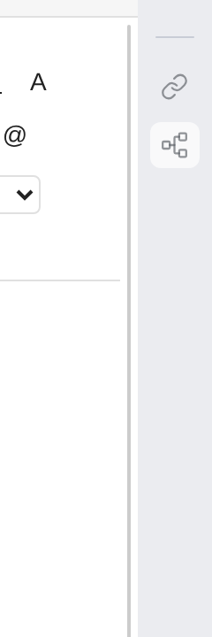
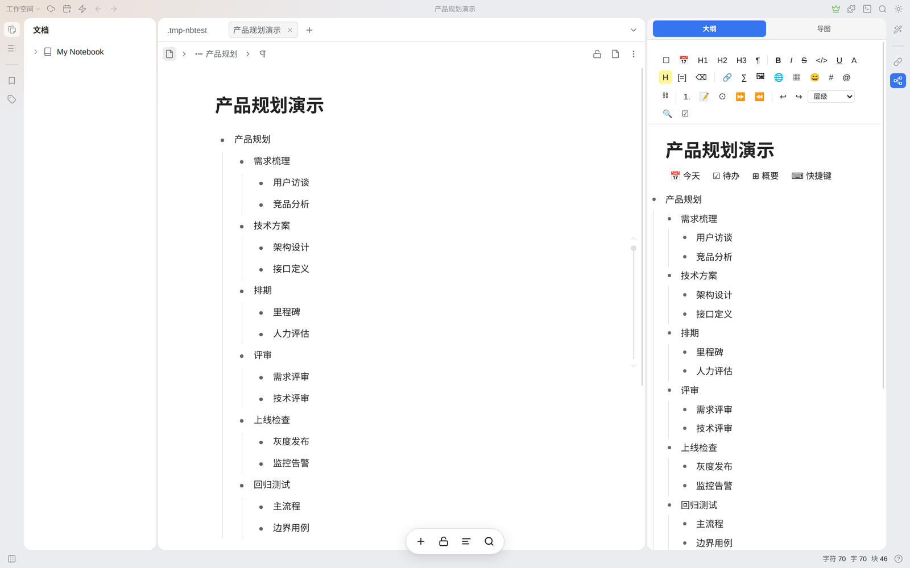
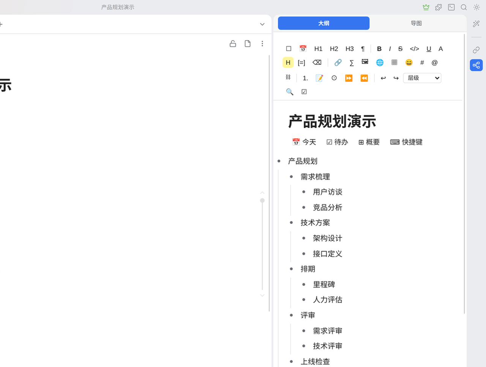
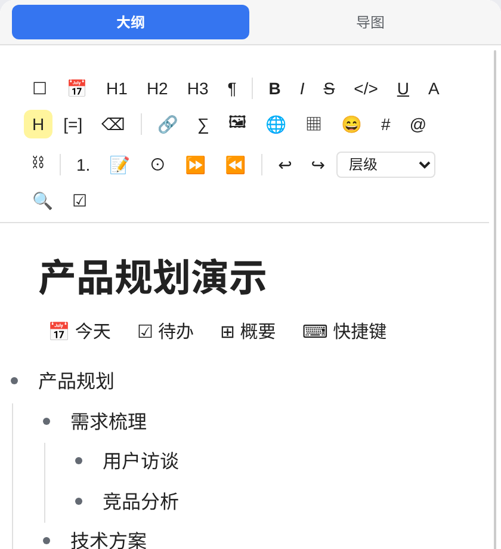
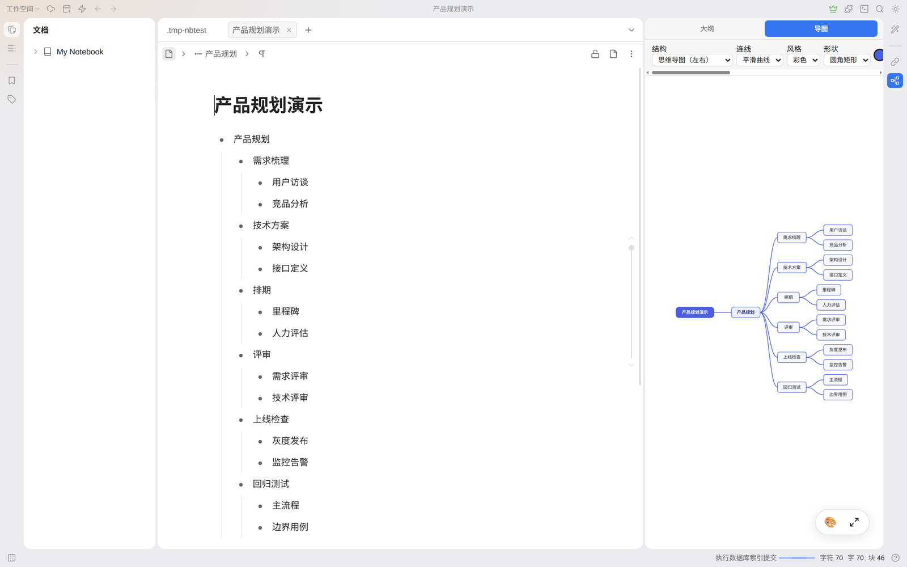
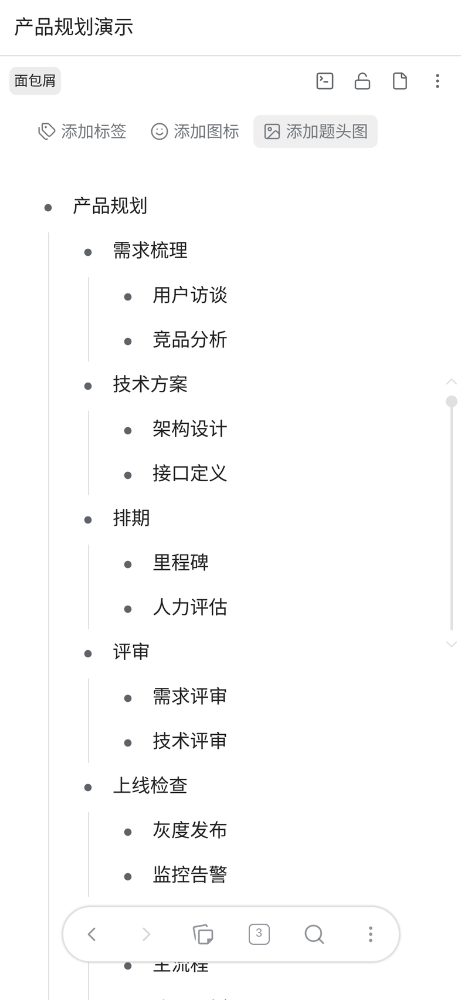
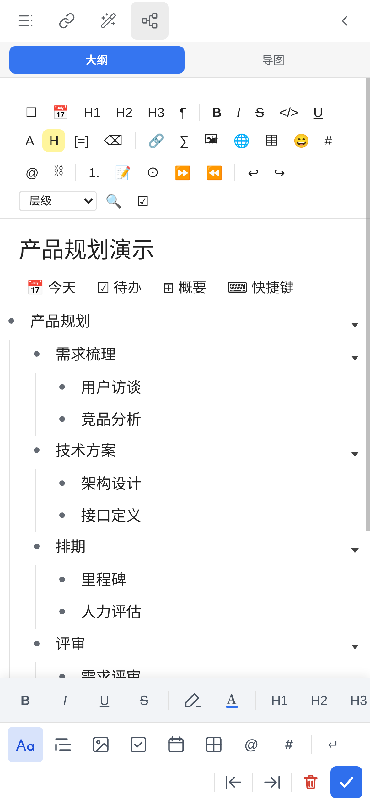

# Getting started

> This document is for **first-time** readers: from installing to getting going.
> For the "why is it designed this way", see [README](../README.zh-CN.md);
> for the keys, see [Shortcuts](SHORTCUTS.md).

---

## What this is

In SiYuan an **outline = a list block**. This plugin gives you two views — outline and mindmap — to
edit those list blocks themselves — no export, no mirroring, no second copy of the data.

Change a node in the plugin and the matching list item in the SiYuan document follows, and vice versa.

---

## 1. Opening the plugin (desktop)

The plugin UI lives in the **right dock**; you do not need to open a new tab.

### Steps

1. Find the **Mindmap** icon in the right dock (a "list → branches" glyph). It usually sits in
   the lower half of the dock, but **where exactly depends on which plugins you have installed** —
   the icon order can be changed in `Settings → Appearance → Dock`, so go by the glyph rather than a position.

   

2. Click it and the panel opens on the right.

   

3. **The panel automatically follows the document you currently have open** — click any document that contains a list in the left column,
   and the panel immediately shows its outline. You do not have to click the panel first.

> **Cannot see the icon?** It may be inside the collapsed area of the right dock. Move the mouse to the bottom of the right dock
> and a nine-dot icon appears; click it to expand all icons.

### You can also use the command palette

`Alt+Ctrl+P` (on macOS `⌥⌘P`) opens the command palette; type "Mindmap" (on a Chinese UI: 导图).

The plugin registers three entries; they show up under `Settings → Keymap → plugin`:

| Entry | Default key (Win/Linux) | macOS | What it does |
|---|---|---|---|
| **Open mindmap** | `Alt+Ctrl+O` | `⌥⌘O` | Opens a new "Mindmap" tab |
| **Insert mirror block** | `Alt+Ctrl+I` | `⌥⌘I` | Embeds the mindmap **at the end of the document body** |
| Open panel | (unbound) | | Same as clicking the right-dock icon |

> On Windows / Linux SiYuan shows `⌘` as `Ctrl+` and `⌥` as `Alt+`,
> so the same combination appears in Settings as `Alt+Ctrl+O` — the order differs, the keys are the same.

> Why `O` and `I`: **both keys are free in SiYuan's built-ins**.
> The plugin used to use `⌥⌘M`, but SiYuan had long since taken it (`/editor/insert/memo`, insert memo) —
> with two commands bound to one key, which one takes effect depends on who grabs the event first, which is a coin toss.
> It now uses combinations that do not collide with built-in keys, checked by `src/plugin/hotkey-collision.test.ts`
> on every test run (against the `__fixtures__/siyuan-keymap.json` snapshot).

---

## Demo

This recording walks through the whole flow (about 36 seconds, silent):

**Open the panel → select a node → Alt+click to collapse/expand → switch to the mindmap → change the color theme → change the layout structure → change the lines → switch back to the outline**

> **On GitHub, click the image above** to download/play the full recording
> (GitHub filters out the `<video>` tag, so a cover image plus a link is used here).
>
> Reading locally it plays directly: `docs/media/demo-desktop.mp4` (36 seconds, silent)
> There is also a WebM version: `docs/media/demo-desktop.webm`

---

## 2. The two views

The top of the panel has two toggle buttons: **Outline** and **Mindmap**.

### Outline view

An outline editor similar to Mubu / Workflowy:

- Top toolbar: to-do, date, bold, italic, strikethrough, inline code,
  underline, highlight, quote, link, formula, image, table, emoji, tag, bidirectional link…
- A collapse arrow on the right of each node row
- Drag the dot on the left to move a node (three drop zones: above / middle / below)

### Mindmap view

Four dropdowns at the top adjust the appearance live:

| Control | Values |
|---|---|
| **Structure** | Right (default), Balanced, Left, Down, Alternating -- five layouts, from the toolbar dropdown |
| **Line** | Smooth curve, Rounded polyline, Right-angle polyline |
| **Style** | Colorful, Mono, Slate, Brown, Green, Orange, Blue, Dark (8 in all) |
| **Shape** | Rounded rectangle, Rectangle, Pill, Underline, Hexagon, Cut-corner rectangle, Tag |

> The values above are **exactly the same** as what you see in the plugin, not an illustration. 

Two floating buttons in the bottom-right corner: 🎨 switch the color theme, ⤢ fit to canvas.

---

## 3. Basic operations

Everything below holds in **either view**.

### Create / edit

| Action | How |
|---|---|
| New sibling node | With the cursor at the end of a node, press `Enter` |
| New child node | `Tab`, or press `Enter` at the end of the line and then `Tab` |
| Edit the text | Just type |
| Add a note | `Shift+Enter` expands the attached paragraphs |
| Delete a node | `Ctrl+Shift+Backspace` |

### Moving

| Action | How |
|---|---|
| Move up / down | `Alt+↑` / `Alt+↓` |
| Indent / outdent | `Tab` / `Shift+Tab` |
| Move by dragging | Hold the **dot** on the left and drag it to the target position |

While dragging, drop hints appear around the dot: drop on the **top** of a node to make it a sibling, on the **middle** to make it a child,
on the **bottom** to make it the next sibling.

### Collapsing

| Action | How |
|---|---|
| Collapse / expand the current node | `Alt+click the dot` |
| Collapse the siblings | `Ctrl+Shift+.` |
| Collapse / expand everything | `Alt+Shift+.` |
| Collapse by level | `Ctrl+Alt+1/2/3` |

### Focus (zoom)

When there are too many nodes, you can "step into" one branch and edit it on its own:

- **Click the dot** → show the map rooted at that node (the breadcrumb shows the path)
- Click that dot again, or press `Alt+←` → go back up one level

---

### Multi-select and bulk actions

Once you select **two or more** nodes, a bulk toolbar appears above them,
letting you do all of this to them at once: Indent / Outdent / Move up / Move down / Set to-do / Complete /
Clear to-do / Delete.

| What you want | How |
|---|---|
| Add one to the selection | `Ctrl` (macOS `⌘`) + click |
| Select a contiguous range | Click the start, then `Shift` + click the end |
| Select several in a row | Click the first, then press `Shift+↑` / `Shift+↓` |
| Select all | The `☑` in the toolbar |
| Clear the multi-selection | `Esc`, or just click somewhere else |

> **A plain click (no modifier) = edit that line**, and it clears the current multi-selection.
> To keep the selection, use `Ctrl+click`.

#### Summary, link lines, the mask and the due date are not available

They were removed. SiYuan has no native way to store any of them, so a summary (a pair of braces), a link
line (a dashed arrow between two topics), the inline-code mask and the due date could never survive a
reload —— they lived only until you closed the document, while the toolbar went on offering them. Rather
than keep a control whose result disappears, all four are gone from the product. Existing documents still
open; the braces, arrows, masks and date chips simply no longer appear.

---

## 4. Mobile

Mobile **has no right dock**, so the entry point differs from the desktop.

### Steps

1. Open any document.
2. Tap **More** in the toolbar at the **very bottom** of the screen (the `⋯` on the far right).

   

3. In the menu that opens, scroll down to the **Plugin** group and tap **原生大纲导图 - 导图** (English UI: Native Outline & Mindmap - Mindmap).

   The panel slides out from the right and shows the current document's outline — the same UI as on the desktop:

   

4. The bottom of the panel has the same toolbar as the desktop, and you can edit right there.

> **Tip**: SiYuan's mobile bottom bar (navigation bar) can be customized. Once you have gone through these 3 steps,
> the plugin icon appears in the "More" menu; if your SiYuan version supports pinning a plugin dock to the bottom bar,
> you can then open it with one tap instead of digging through the menu every time.

> **Another way**: type `/` in the body to bring up the slash menu and choose **Insert mindmap**,
> which inserts a **mirror block** into the body — the mindmap scrolls with the document and is there on export too.
> This needs an external keyboard (a phone's on-screen keyboard cannot drive the `/` menu reliably),
> and on the desktop the command palette's **Insert mirror block (embed the mindmap in the document)** does the same (`Alt+Ctrl+I`, macOS `⌥⌘I`).

### Touch gestures

| Gesture | Action |
|---|---|
| **Long-press 350 ms, then drag** | Move a node (touch devices do not fire HTML5 drag, hence the long press) |
| Tap the dot | Focus / go back |
| Double-tap a node | Edit |

---

## 5. FAQ

**Q: The panel shows "No document open"?**

Just click any document in the left column. The panel follows automatically; there is nothing to link by hand.

If you have a document open but the panel is still empty, make sure the document **contains a list block**
(the `- 内容` form, i.e. a dash plus text); a purely empty document, or one with only paragraphs, has no outline to show.

**Q: A new document keeps showing "This document has no content yet", and adding content does not change it?**

This used to be a real bug (fixed in v0.1.4). Now: **add a list item to the body and the panel catches up on its own**.

Note that what counts is a **list item** (type a leading `- `, or use the list button in the toolbar),
not an ordinary paragraph — the outline only takes list items; paragraphs do not enter it, by design.

If you really only wrote a paragraph and want an outline: press `Tab` on that paragraph (or add a list item),
and it appears in the panel. You can also press `Enter` right in **the panel** to create the first node.

**Q: I changed something in the panel but the SiYuan document did not change?**

Normally it writes back in real time. If "Saving…" stays on screen for a long time,
an error banner appears in the top-right corner; follow what it says.

**Q: Can I uninstall it? What happens to my notes after that?**

Absolutely. The plugin **writes no custom attributes and generates no private format** —
nodes are just ordinary list items. After uninstalling, your documents stay readable, searchable and editable as before.

**Q: How does this differ from "Export image"?**

This plugin does not export. The mindmap you see is rendered **live** from the list blocks;
there is no "the source changed after exporting, so export again" problem.

---

## 6. More

- [Full shortcut list](SHORTCUTS.md)
- [Feature list](FEATURES.md)
- [How data maps to SiYuan blocks](DATA-FORMAT.md)
- [Architecture and implementation](ARCHITECTURE.md)
